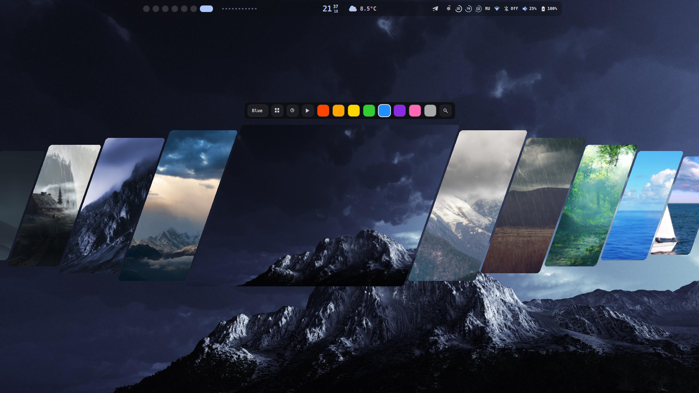
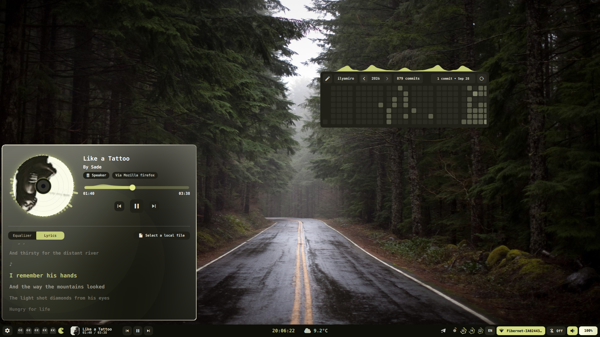
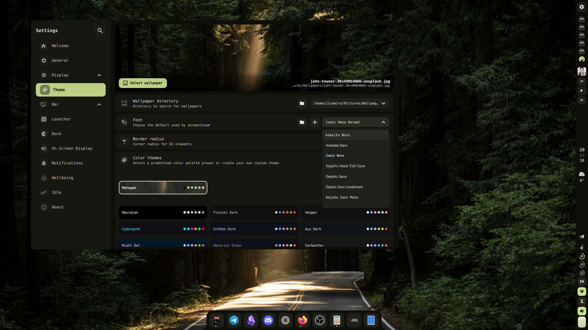
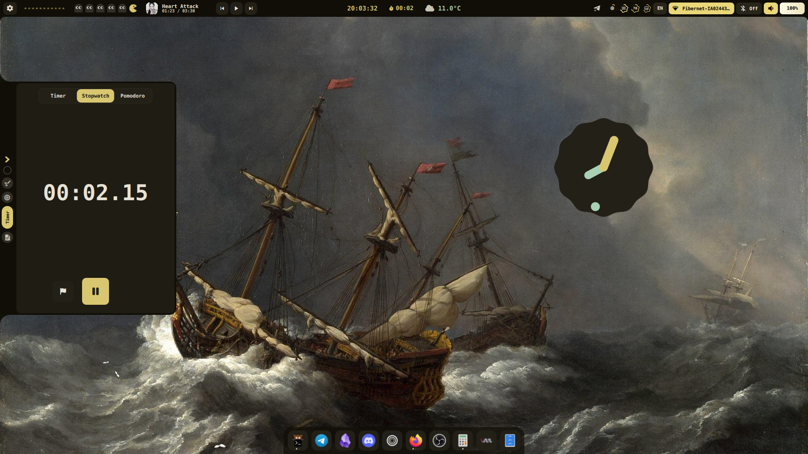

## Previews

| | |
|---|---|
|  |  |
|  |  |

---

## Installation

> [!TIP]
> Full installation and configuration instructions live in this repository: **[mora1ss/wayshell](https://github.com/mora1ss/wayshell)**.

> [!IMPORTANT]
> **Migrating from v1:** All previous configuration will be backed up and unused. Configuration of compositor settings such as monitors, keybinds, and autostart is now up to you, as the project migrated from being dotfiles to being a shell.

### Arch Linux, Fedora, Void Linux and their derivatives

For Arch-based distributions (including systemd, OpenRC, and other init systems), for Fedora-based distributions such as Nobara and Ultramarine, and for Void Linux (glibc and musl), run the automated installation script. It detects your distribution and uses `pacman`, `dnf` or `xbps`.

```bash
bash -c "$(curl -fsSL https://raw.githubusercontent.com/mora1ss/wayshell/main/install/install.sh)"
```

> [!NOTE]
> To update, run the script again and choose "update".

---

### NixOS

See the [NixOS installation guide](https://github.com/mora1ss/wayshell/blob/main/docs/installation/nixos/flake.md) for flake setup, the NixOS and Home Manager modules, and updating.

---

## Audio engine

The equalizer, balance, mono, channel swap, dynamic range modes and the dynamic EQ run on [serpantinum-audio](https://github.com/ilyamiro/serpantinum-audio), a small PipeWire processor that replaces EasyEffects. The installer and the packages install it, and on the first start after updating, Wayshell hands your audio over from EasyEffects. See the [audio engine guide](https://github.com/mora1ss/wayshell/blob/main/docs/components/serpantinum-audio.md).

---

## Blue light filter

The blue light filter and its day and night schedule run on [serpantinum-gamma](https://github.com/ilyamiro/serpantinum-gamma), a small Wayland daemon that replaces wl-gammarelay-rs. The installer and the packages install it. Wayshell starts it the first time a filter is turned on and stops it on exit.

---

## Supported compositors

Hyprland, Niri, Sway and Mango. The installer detects the running compositor and deploys its configuration. On Fedora, Mango is installed from the Terra repository. On Void Linux, Hyprland is installed from the third-party black-hole.dev repository.

---

## Running

To run the shell, launch `wayshelld start`

For configuration, see the [configuration guide](https://github.com/mora1ss/wayshell/blob/main/docs/configure/Configure.md).

---

## License

Copyright (C) 2026 Illia Miroshnichenko

This project is licensed under the GNU Affero General Public License version 3, or (at your option) any later version. See the [LICENSE.md](LICENSE.md) file for the full license text.

